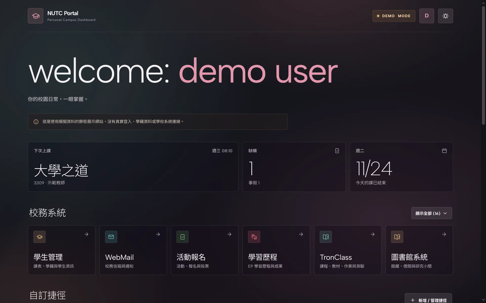
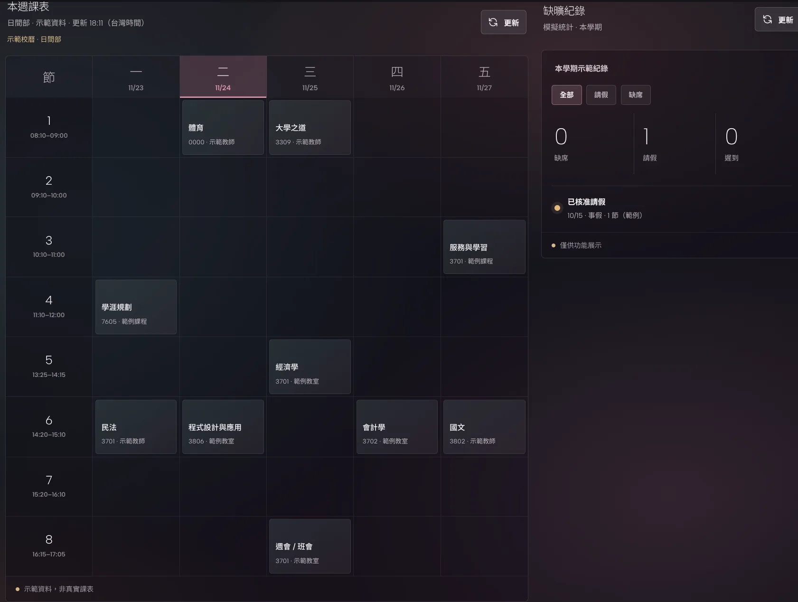
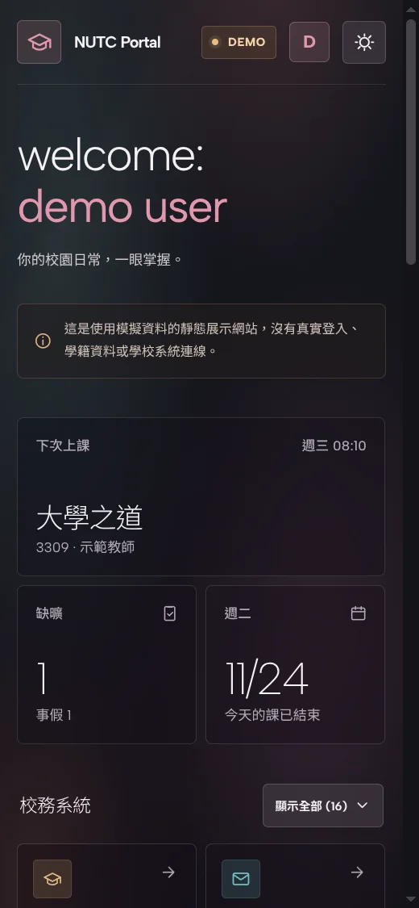
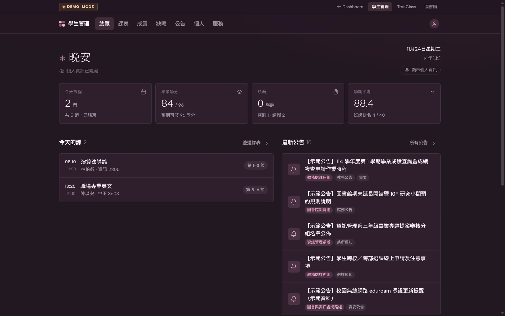
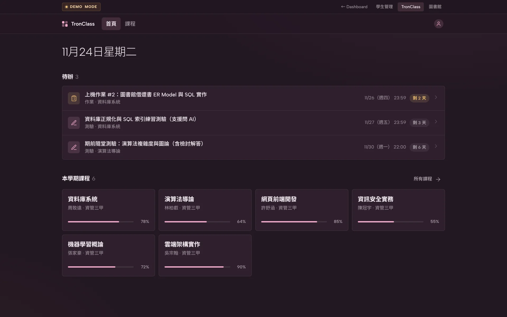
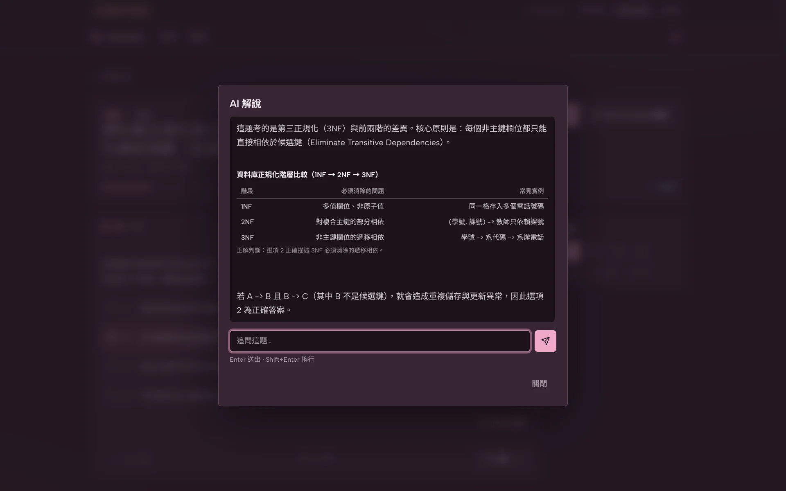
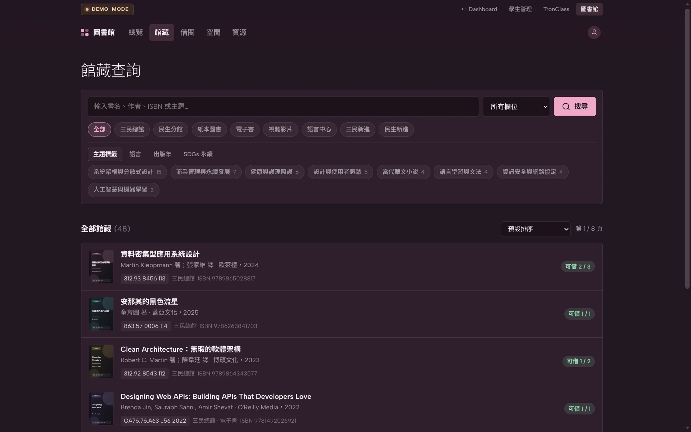
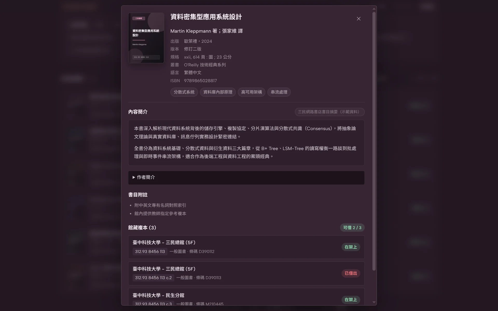
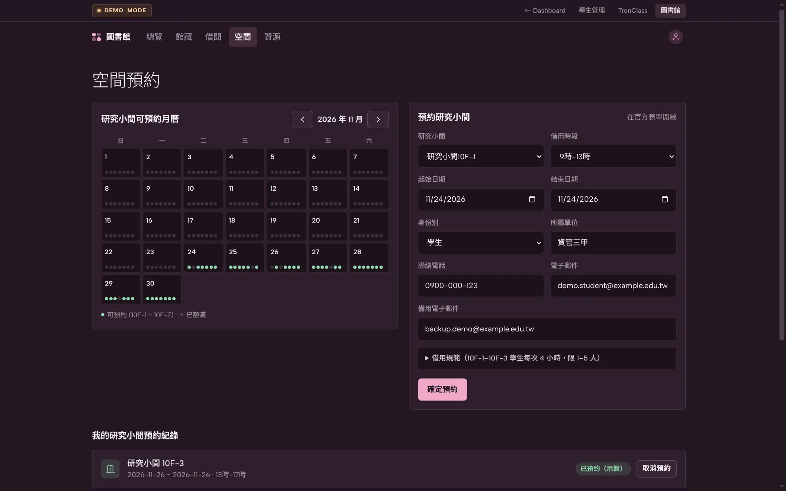

<!-- **FOR AGENTS**: **DO NOT** modify the warning text. keep it **AS IS**. -->

> [!WARNING]
> **VIBE CODE REPO AHEAD!**
> 
> This project is entirely vibe coded with GPT-5.6 Sol, GPT-6, Opus 5.5, Deepseek v4.1 Flash 1017, Gemini 4 Neon and Gemini 4 Hydrogen, thus support and bug fixes are not guaranteed. Use at your own risk.


# 中科大學生用自架 ePortal（NUTC Portal）

> **為什麼要做這個？**  
> **因為中科大的 ePortal 系統真的太過時太難用了**，只好動用最新最潮的 LLM 技術去接學校系統、套一個現代好用的深色介面來讓自己每天用得順手一點。

把國立臺中科技大學學生的**課表、缺曠紀錄、成績與修課進度、TronClass 課程測驗、圖書館館藏與空間預約**全部整合在同一個深色現代介面——登入一次就能長期維持連線，不用每次開學校網頁都重打帳密跟驗證碼。

> [!NOTE]
> 本專案為非官方個人專案，與國立臺中科技大學官方無關。  
> 想先看實際畫面與操作手感，可以直接點開 [**線上互動展示（Demo）**](https://rynowastaken.github.io/Personal-NUTC-Eportal/)（使用範例資料，不會連線校方系統）。

---

## 一眼看懂它特別在哪

一般爬蟲或第三方工具常會把你的帳號流量全都代理經過 server；這套系統只在你自己的主機上用 headless Chromium 幫你**維持 ePortal 登入狀態**，真正操作各子系統時由**你自己的瀏覽器直接連線**：

- Server 只負責在背景接好 ePortal SSO 認證（SSO token / form）後交接給你的瀏覽器。
- 瀏覽器直接向目標系統建立獨立連線，server 不會留存你在子系統上的操作內容，也沒有密碼落盤的問題。

---

## 畫面預覽與線上展示

以下截圖皆來自 [**公開展示網站（GitHub Pages）**](https://rynowastaken.github.io/Personal-NUTC-Eportal/)，使用範例資料。



<table>
  <tr>
    <td width="68%"></td>
    <td width="32%"></td>
  </tr>
  <tr>
    <td align="center">本週課表與缺曠紀錄</td>
    <td align="center">手機版 Dashboard（RWD）</td>
  </tr>
</table>

<table>
  <tr>
    <td width="50%"></td>
    <td width="50%"></td>
  </tr>
  <tr>
    <td align="center">學生管理中心（<code>/ais</code>）總覽、課表與成績</td>
    <td align="center">TronClass 學習中心（<code>/tronclass</code>）待辦與課程進度</td>
  </tr>
  <tr>
    <td width="50%"></td>
    <td width="50%"></td>
  </tr>
  <tr>
    <td align="center">練習測驗內建「問 AI 這題」解說與表格整理</td>
    <td align="center">圖書館全館館藏、標籤篩選與即時可借狀態</td>
  </tr>
  <tr>
    <td width="50%"></td>
    <td width="50%"></td>
  </tr>
  <tr>
    <td align="center">自動補齊內容／作者簡介與複本狀態之書目詳情</td>
    <td align="center">10F 研究小間（10F-1–10F-7）月曆空位查詢與預約</td>
  </tr>
</table>

[**NUTC Portal Demo**](https://rynowastaken.github.io/Personal-NUTC-Eportal/) 以純靜態範例資料完整模擬整個平台操作體驗：除了首頁 Dashboard 與外觀設定外，還可直接點進 **學生管理（課表／成績／修課標準／公告）**、**TronClass（課程教材、練習測驗與模擬問 AI 助教）** 及 **圖書館（全館館藏、標籤篩選、書目詳情、續借、10F 研究小間月曆預約與資料庫搜尋）**，所有資料皆於瀏覽器本機模擬，**不會登入校方系統或讀取任何真實個人資料**。

Demo 原始碼位於 [`demo/`](demo/)，自動部署流程設定在 [GitHub Actions](.github/workflows/demo-pages.yml)；若需要自行啟用，請參考 [GitHub Pages 啟用說明](docs/demo.md)。

---

## 核心功能

### 1. 首頁 Dashboard（`/`）
- **本週課表與缺曠統計**：Server 定時讀取 AIS 課表與各類別缺曠統計並快取 5 分鐘，支援假日／停課標示。
- **五大常用系統快速啟動**：學生管理系統、WebMail、活動報名、EP 學習歷程、TronClass，以及一鍵前往校內系統中心。
- **自訂常用網站捷徑**：支援新增、編輯、釘選至首頁與刪除 HTTP(S) 捷徑（最多 30 個，存於伺服器讓各裝置共用）。
- **個人化外觀**：自訂顯示名稱、頭像、主題色彩／明暗／飽和度，以及自訂背景圖片、0–200% 獨立背景亮度與捲動視差效果（支援系統「減少動態效果」）。

### 2. 學生管理中心（`/ais`）
- 將原本散落在舊系統頁面的**本週課表、缺曠紀錄、成績、修課進度、個人資料與校務公告**集中在單一乾淨工作區，個人識別資訊預設遮蔽，需要時再手動切換顯示。

### 3. TronClass 學習中心（`/tronclass`）
- 直接在 Portal 內瀏覽**待辦事項、課程列表、章節教材、影片、成績與作業／測驗資訊**。
- 支援在 Portal 內作答線上測驗（倒數計時、自動儲存、送出交卷），並完整保留原測驗的防作弊機制（全螢幕、切換視窗警告、停用複製與右鍵）；需要監考的測驗與繳交作業會自動保留在原站進行。
- 練習測驗內建「**問 AI 這題**」解說與追問（可於 TronClass 頁面右上角選單的「AI 助手設定」設定 Provider 與 API Key，金鑰僅保存在 Server）。
- 伺服器透過 ePortal 取得的 TronClass 登入資訊代為讀取資料（存放於 `data/tronclass-session.json`），所有頁面均提供「在 TronClass 開啟」原站 SSO 備援。

### 4. 圖書館中心（`/library`）
- **現代化館藏查詢**：預設即可瀏覽全館館藏（支援關鍵字、欄位、館別／類型／語言／出版年／主題／SDGs 標籤篩選與排序），串流加速載入、自動依 ISBN 從網路補齊缺漏書籍封面與內容／作者簡介，並即時顯示可借複本狀態與頁碼跳轉。
- **借閱帳戶與線上續借**：集中查看借閱中館藏、預約狀態、罰款與借閱歷史，並可勾選可續借館藏一鍵送出續借請求。
- **空間預約**：視覺化瀏覽 10F 研究小間（`10F-1`–`10F-7`）月曆空位、點選日期直接帶入表單送出預約或線上取消，以及快速連結團體討論室／放映室預約。
- **電子資源與工具**：即時搜尋校內電子資料庫（支援學院、語系快速篩選）與一鍵下載 EndNote 安裝檔。

### 5. 一次登入、長效維持與跨裝置支援
- **不需重打密碼的持久連線**：`.eportal-profile/` 保存登入後的 Chromium 狀態，重開 server 不用重登；預設每 **5 分鐘** 自動執行 keepalive 檢查並延續 session。
- **網頁表單安全登入**：透過內建 Login Bridge 完成帳密與圖形驗證碼／MFA 登入，帳密僅存在執行期間記憶體，不寫入硬碟與 log。
- **桌面與手機 RWD ＋ Cloudflare Access**：手機與電腦皆有最佳化版面，對外架設可搭配 Cloudflare Access 保護。

> [!TIP]
> AIS 網站本身的 Cookie 存在使用者個人瀏覽器中，因跨網域安全限制，Dashboard 無法直接讀取或清除 `ais.nutc.edu.tw` 的 Cookie。若只在個人瀏覽器的 AIS 頁面看到逾期提示，回 Dashboard 點 **學生管理** 或 **重新連接 AIS** 即可重新完成 SSO。

---

## 快速開始

### 環境需求
- **Node.js 18 以上** 與 **npm**
- **NUTC ePortal 帳號**
- 一台可連網的電腦（個人筆電、家用主機、Raspberry Pi 或 VPS 皆可）

```bash
git clone https://github.com/Rynowastaken/Personal-NUTC-Eportal.git
cd Personal-NUTC-Eportal

npm install
npm run install-browser
npm run doctor
npm start
```

啟動後打開瀏覽器前往 `http://localhost:4174` 即可使用（本機使用不需設定 Cloudflare Access）。

> `npm run install-browser` 會安裝 Playwright Chromium，並在多數 Linux 發行版上自動補齊系統相依套件。

### 第一次登入

1. 開啟 Dashboard 後點擊 **登入 Server ePortal**。
2. Server 會在背景啟動 Playwright Chromium，透過 **Login Bridge** 把 ePortal 官方登入表單（包含驗證碼與 MFA）顯示在網頁上。
3. 直接用手機或電腦填寫送出即可（server 本身不需任何桌面 GUI 環境）。
4. 登入成功後，瀏覽器狀態會自動保存於：

```text
.eportal-profile/
```

> [!IMPORTANT]
> `.eportal-profile/` 等同你已登入校務系統的帳號憑證，**請勿 commit、公開上傳或複製到不信任的機器**。

---

## 它是怎麼運作的（白話版）

1. **資料擷取與整合** — 對於 AIS 課表缺曠、TronClass 與圖書館等系統，server 使用已建立的 session 讀取並適度快取資料，將雜亂的舊表單轉譯為統一的 JSON 與現代前端介面。
2. **SSO 模組直連交接** — 點擊外部模組（如學生管理、WebMail）時，server 代為點擊 ePortal 入口取得一次性 SSO 轉導 URL 或 POST 表單交給你的瀏覽器完成登入，目標系統 session 只存在你自己的瀏覽器裡。
3. **活動報名中繼 proxy** — 因舊系統使用純 HTTP 無法直接進行安全 SSO 交接，server 會為活動報名開啟有效 30 分鐘的本機 reverse proxy 即時轉譯頁面。
4. **Login Bridge** — 所有帳密、圖形驗證碼與二次驗證直接從 ePortal 即時轉呈並輸入 Chromium，憑證只存在記憶體中，不寫檔、不記錄 log。
5. **Keepalive 與自動健康檢查** — 預設每 **5 分鐘** 檢查一次 ePortal session；進站與切回分頁時也會安全檢查狀態，確認過期才會引導至登入頁（具備冷卻時間防止無限重導）。

---

## 日常使用與個人化設定

### 課表假日、補課與學制切換
- **國定假日**：依年份讀取 [中華民國政府行政機關辦公日曆表](https://data.gov.tw/dataset/14718) 的 [TaiwanCalendar JSON](https://github.com/ruyut/TaiwanCalendar)（快取 24 小時；離線時使用舊快取並以校曆例外備援）。
- **中科大校曆例外**：[`src/nutc-calendar-overrides.json`](src/nutc-calendar-overrides.json) 依 [中科大 115 學年度行事曆](https://aca.nutc.edu.tw/p/412-1015-4596.php) 維護；遇補班／調課或新學年行事曆公布時直接更新該檔即可。明確單日例外優先於國定假日，一般週六日不會自動視為停課日。
- **學制選擇**：於網站右上角 **設定 → 課表設定** 切換「日間部（預設）」、「進修部夜間班」或「進修部假日班」，按 **Apply** 立即生效（存於 `data/dashboard-preferences.json`，**無需修改環境變數或重啟服務**）。
- **資料格式參考**：`days` 支援 `{ "date": "2027-04-02", "label": "校慶補假", "noClass": true, "programs": ["day", "evening", "weekend"] }`；`ranges` 支援 `{ "start": "2027-01-11", "end": "2027-02-21", "label": "寒假", "noClass": true, "programs": ["day"] }`；照常上課覆寫國定假日可將 `noClass` 設為 `false`。

### 背景圖片亮度與自訂捷徑
- **背景圖片與亮度**：背景圖檔案存於 server 共用；右上角 **網站設定 → 背景圖片 → 背景亮度** 可於 0–200% 間即時預覽並套用（**Apply** 儲存、**Reset** 回復 100%），數值儲存在目前瀏覽器，不會影響卡片與文字對比。
- **自訂網頁捷徑**：點選首頁「自訂捷徑 → 新增 / 管理捷徑」可設定名稱、HTTP(S) 網址（不允許內含帳密）及是否釘選至首頁，最多 30 組，存於 `data/dashboard-preferences.json` 全裝置共用。

### AIS 登入逾期時怎麼辦
- **重新連接 AIS**：在 Server ePortal 仍有效的情況下，為目前瀏覽器重新走一次 AIS SSO。
- **重新登入 ePortal**：清除 server 保留的 ePortal 驗證 Cookie 並開啟官方登入表單，重新建立長期連線。
- **仍顯示「驗證失敗／連線可能逾期」**：因 `ais.nutc.edu.tw` 的 Cookie 存在你的瀏覽器端，請清除瀏覽器中**僅 `ais.nutc.edu.tw` 的 Cookie／網站資料**後，再從 Dashboard 點擊 **學生管理** 完成 SSO。

---

## 部署指南

### 區網內使用（家用 Server / 樹莓派）
預設監聽埠為 `4174`，若需同區網其他手機或平板存取：

```bash
HOST=0.0.0.0 PORT=4174 npm start
```

其他裝置開啟 `http://<Server-IP>:4174` 即可（請僅於受信任的區網環境使用，勿直接把未保護的 port 暴露至公網）。

### 公網部署（Cloudflare Access + Caddy）

建議架構：

```text
Internet
  ↓
Cloudflare Access（驗證使用者身份）
  ↓
Caddy HTTPS Reverse Proxy
  ↓
NUTC Portal（127.0.0.1:4174）
```

在 Linux server 上執行設定精靈產生 `.deploy/` 部署檔：

```bash
npm run deploy:configure
```

檢查設定無誤後安裝並啟用服務：

```bash
sudo npm run deploy:configure -- --install
sudo caddy validate --config /etc/caddy/Caddyfile
sudo systemctl daemon-reload
sudo systemctl enable --now personal-nutc-eportal
sudo systemctl reload caddy
```

Cloudflare 後台的 DNS、Access Application 與 Origin CA 憑證設定，請參考 [Cloudflare Access 部署文件](docs/cloudflare-access.md)。

---

## 常用指令

| 指令 | 用途 |
| --- | --- |
| `npm start` | 建置前端資源並啟動 NUTC Portal |
| `npm run verify` | 依序執行建置 (`build`)、語法檢查 (`check`) 與自動化測試 (`test`) |
| `npm run doctor` | 檢查 Node、Playwright 與環境設定是否就緒 |
| `npm run check` | 檢查專案內所有 JavaScript 語法 |
| `npm test` | 執行所有自動化測試 |
| `npm run install-browser` | 安裝 Playwright Chromium 及系統相依套件 |
| `npm run portal:status` | 在終端機檢查目前 ePortal 登入狀態 |
| `npm run login` | 使用有視窗畫面的 Playwright 手動登入（備援方案） |
| `npm run deploy:configure` | 互動產生 systemd / Caddy 部署設定 |
| `npm run deploy:check` | 檢查部署設定是否完整 |

## 環境變數

本機使用通常維持預設值即可：

| 變數 | 預設值 | 說明 |
| --- | --- | --- |
| `PORT` | `4174` | HTTP 監聽埠 |
| `HOST` | `0.0.0.0` | 繫結 IP |
| `EPORTAL_KEEPALIVE_MINUTES` | `5` | 自動檢查並延續 session 的間隔（分鐘）；設為 `0` 關閉 |
| `EPORTAL_LOGIN_BRIDGE_TTL_MINUTES` | `15` | Login Bridge 登入視窗有效時間（分鐘） |
| `EPORTAL_RESTART_MODE` | `self` | 由 systemd 管理時設 `exit`（觸發非零結束碼讓 `Restart=on-failure` 自動重啟） |
| `CLOUDFLARE_ACCESS_ENFORCE` | — | 設為 `1` 強制於 origin 驗證 Cloudflare Access JWT |
| `CLOUDFLARE_ACCESS_TEAM_DOMAIN` | — | Cloudflare Access Team Domain |
| `CLOUDFLARE_ACCESS_AUD` | — | Cloudflare Access Application AUD |

---

## 前端開發與建置（Vite + React / shadcn/ui）

專案使用 **Vite + Tailwind CSS** 將前端樣式與漸進遷移的 React／shadcn-style UI 元件編譯至 `public/generated/`（不提交進 Git，`npm install` 會透過 `postinstall` 自動建置）；AIS、TronClass 與圖書館等子頁面目前採用對應原生的低依賴 ESM／CSS 模組。

- **開發／驗證前請執行：** `npm run verify`
- **systemd 注意事項：** 服務直接執行 `node server.js`，若使用 `npm install --ignore-scripts` 或拉取新碼後重啟服務前，請務必確認已執行 `npm run build`（或 `npm run verify`），以確保 `public/generated/` 存在最新靜態資源。
- 更多模組分工與流程請見 [程式架構與工作流程](docs/architecture.md)；新增 shadcn/ui 元件可編輯 `frontend/src/components/ui/` 或依 `components.json` 執行 CLI 後微調 Tailwind 相容性。

---

## 資料與隱私

本機與個人設定主要保存於以下兩個目錄（均已加入 `.gitignore`）：

- `.eportal-profile/` — 已登入的 Chromium 瀏覽器狀態（Cookies、localStorage 等）
- `data/` — 個人偏好設定、TronClass／圖書館工作階段、快取資料與自訂捷徑／頭像／背景圖

Login Bridge 處理的帳號密碼與 MFA 驗證碼僅存在於記憶體中，不會寫入磁碟或記錄於 log。

**請永遠不要 commit 或分享：**
- `.eportal-profile/` 與 `data/` 內的任何私人檔案
- 匯出的 Cookie／瀏覽器 Session、JWT／SSO Token、Login Bridge Token
- 含網域／帳號資訊的部署設定秘鑰

---

## 進階文件

- [程式架構與工作流程（Architecture）](docs/architecture.md)
- [Cloudflare Access 公網部署指南](docs/cloudflare-access.md)
- [Userscript / Client Browser 整合](docs/userscript.md)
- [GitHub Pages Demo 建置與部署說明](docs/demo.md)
- [舊版安裝遷移指南（Migration Guide）](docs/migration.md)

大多數使用者只要完成**快速開始**與**第一次登入**就能直接開始使用。
